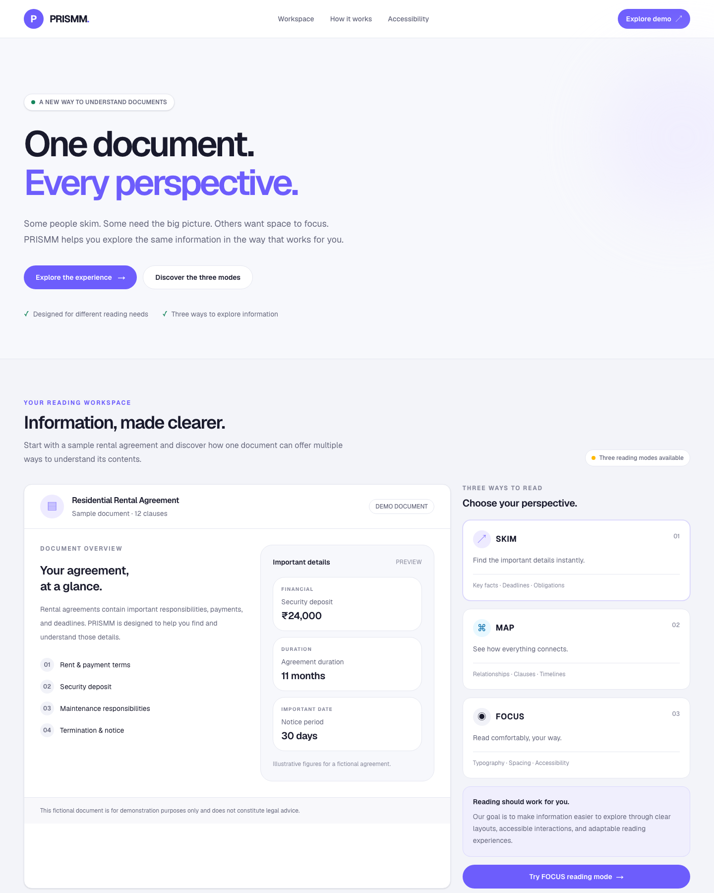
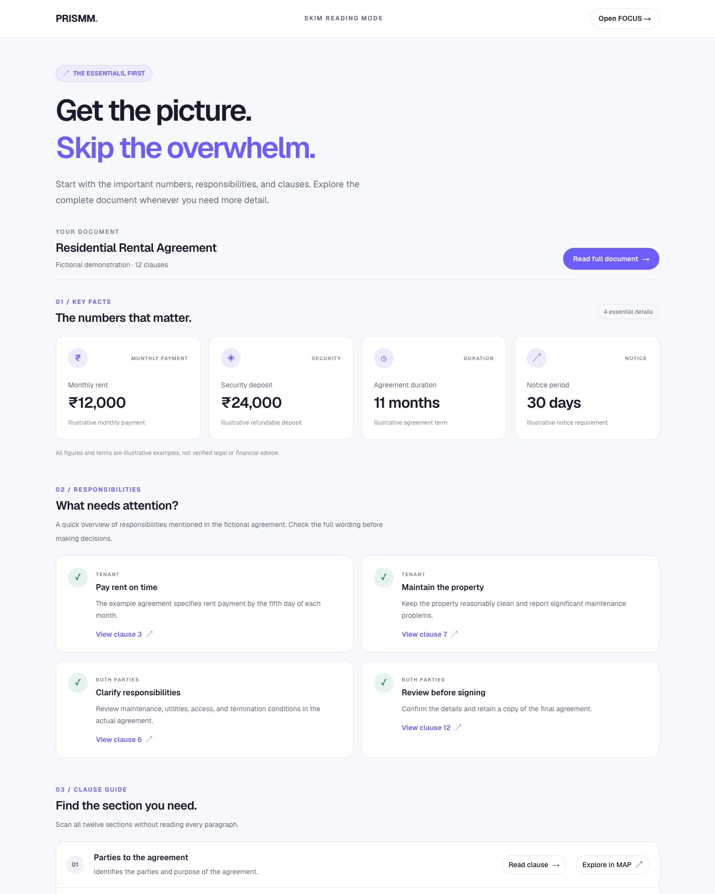
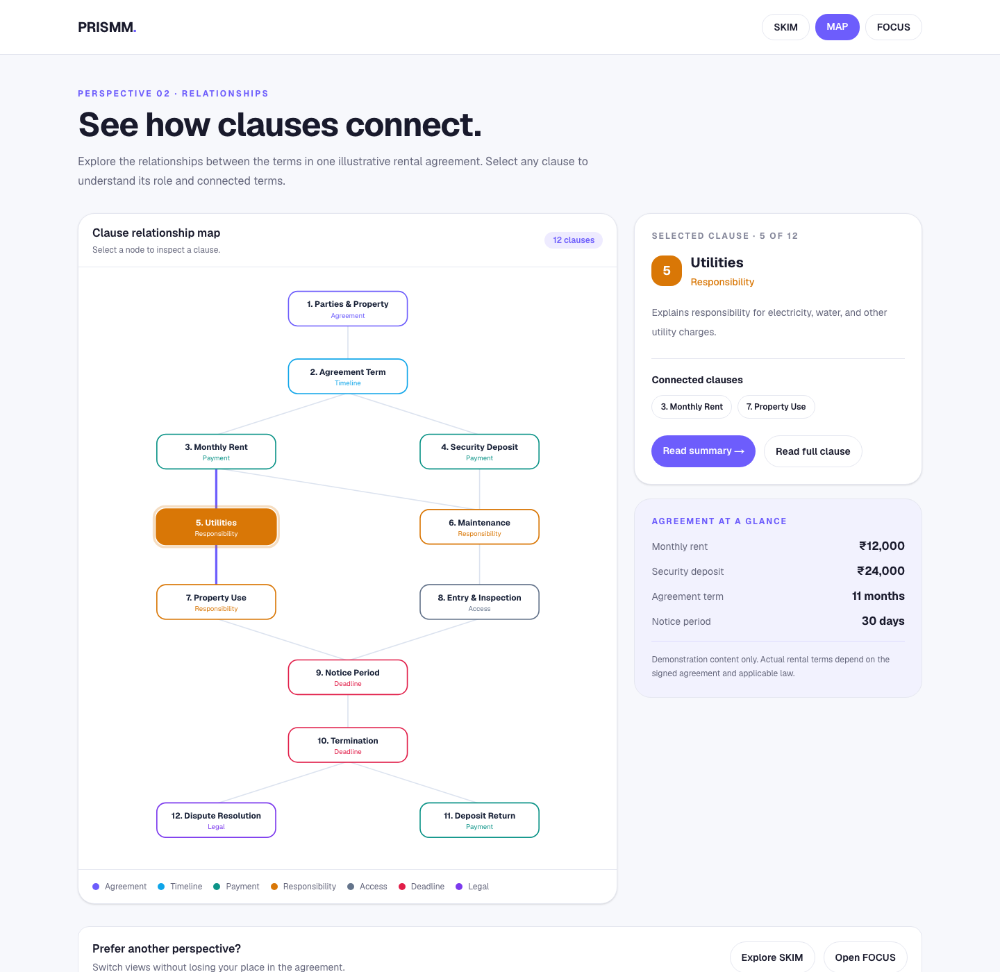
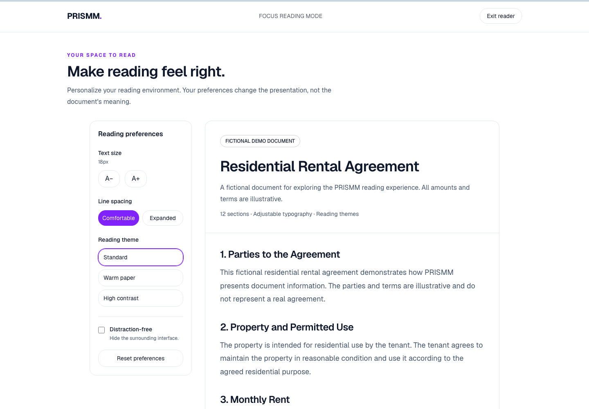

# PRISMM

### One Document. Every Perspective.

PRISMM turns one fictional rental agreement into three connected ways to read: scan the essentials, explore how clauses relate, or settle into the full document with reading preferences that suit you.

**[Open the live demo](https://prismm-kohl.vercel.app)** · [GitHub repository](https://github.com/sahith0405/PRISMM)

## Screenshots

Captured from the live deployment at a 1440px-wide desktop viewport.

### Homepage



### SKIM — Quick understanding



### MAP — Clause relationships



### FOCUS — Comfortable reading



## The idea

Long documents can be difficult to scan, understand as a whole, and read comfortably. PRISMM brings those needs together: its modes are different perspectives on the **same** document, with clause links to move between them.

## Reading modes

### SKIM — Understand quickly

- Surfaces key facts such as rent, deposit, agreement duration, and notice period.
- Summarizes responsibilities and all 12 clauses.
- Links from clauses to their full text in FOCUS and related views in MAP.

### MAP — Understand relationships

- Visualizes 12 clauses and their connections in an interactive SVG map.
- Selecting a node shows its summary and connected clauses.
- Supports direct selection with a query such as [`/map?clause=5`](https://prismm-kohl.vercel.app/map?clause=5).
- Links to the selected clause in SKIM and FOCUS.

### FOCUS — Read comfortably

- Presents the complete fictional agreement with links to its clauses.
- Adjusts text size, line spacing, and reading theme (Standard, Warm Paper, or High Contrast).
- Saves reading preferences in browser local storage.
- Includes a distraction-free reading mode with an exit control.

## A typical reading flow

1. Start in **SKIM** to find the important facts and summaries.
2. Open **MAP** to see how a clause relates to other terms.
3. Follow the clause into **FOCUS** to read its full text.
4. Adjust the reading controls to your preference.

## Technology

- Next.js 16 App Router
- React 19 and TypeScript
- Tailwind CSS 4
- SVG for the clause relationship map
- Vercel for hosting and deployment

## Run locally

Requirements: Node.js and npm.

```bash
git clone https://github.com/sahith0405/PRISMM.git
cd PRISMM
npm install
npm run dev
```

Open [http://localhost:3000](http://localhost:3000) in your browser. The available scripts are `npm run dev`, `npm run build`, `npm run start`, and `npm run lint`.

## Routes

| Route | Purpose |
| --- | --- |
| [`/`](https://prismm-kohl.vercel.app/) | Product homepage and mode selection |
| [`/skim`](https://prismm-kohl.vercel.app/skim) | Key facts, responsibilities, and clause summaries |
| [`/map`](https://prismm-kohl.vercel.app/map) | Interactive clause relationship map |
| [`/focus`](https://prismm-kohl.vercel.app/focus) | Full document and reading preferences |

## Project structure

```text
app/
├── components/
│   ├── FocusReader.tsx
│   ├── MapReader.tsx
│   └── SkimReader.tsx
├── focus/page.tsx
├── map/page.tsx
├── skim/page.tsx
├── globals.css
├── layout.tsx
└── page.tsx
docs/
└── screenshots/
    ├── homepage.png
    ├── skim-mode.png
    ├── map-mode.png
    └── focus-mode.png
```

## Disclaimer

The rental agreement is fictional and provided only to demonstrate the PRISMM reading experience. This project is an educational interface prototype, not legal advice.

## Links

- Live demo: [prismm-kohl.vercel.app](https://prismm-kohl.vercel.app)
- Source code: [github.com/sahith0405/PRISMM](https://github.com/sahith0405/PRISMM)
